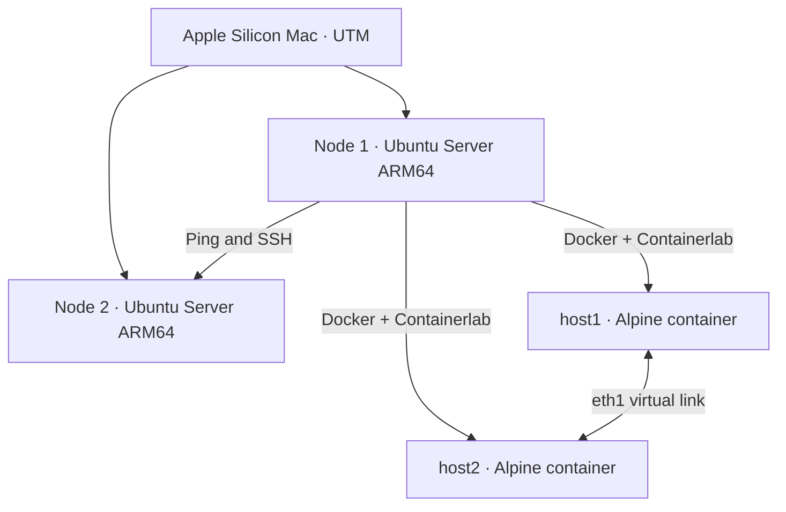

# AI Fabric, Clos & RoCE Lab

> **Status: In progress.** The initial two-host topology has been deployed. The Clos fabric and RoCE exercises are planned.

A hands-on lab for learning the Linux networking, data centre fabric and RDMA fundamentals used in AI and HPC infrastructure. It starts with a small, reproducible network and grows in stages.

## Current setup

- Two Ubuntu Server ARM64 VMs run on an Apple Silicon Mac using UTM.
- The VMs have been tested with ping and SSH from Node 1 to Node 2.
- Node 1 runs Docker and Containerlab. The first topology creates two Alpine Linux containers, `host1` and `host2`, with a virtual `eth1` link between them.
- Containerlab reported both containers running and the virtual link created. IP connectivity across that link has **not yet been confirmed**.



The containers act as network endpoints inside Node 1. They share its Linux kernel and are separate from the two Ubuntu VMs. Docker's management network is separate from the lab's `eth1` link.

## Progress

| Area | Status |
| --- | --- |
| Ubuntu VMs and basic connectivity | Ping and SSH tested |
| Docker, Containerlab and ARM64 image | Installed and checked on Node 1 |
| Two-host topology | Deployed; containers and virtual link created |
| Direct `eth1` IP connectivity | To be tested |
| Spine-leaf / Clos fabric, BGP and ECMP | Planned |
| Distributed workload and Soft-RoCE | Planned |
| Monitoring, troubleshooting and Python checks | Planned |

## First lab: two connected hosts

Topology: [`labs/01-two-hosts/two-hosts.clab.yml`](labs/01-two-hosts/two-hosts.clab.yml)

Requirements: a Linux VM with Docker, Containerlab and an ARM64-compatible `alpine:3` image. Commands below run on **Node 1**.

If the existing `aiinfra` lab is already running, inspect it rather than deploying another copy:

```bash
sudo docker ps --filter name=clab-aiinfra-
```

For a fresh setup, clone this repository on Node 1 and deploy the topology:

```bash
git clone https://github.com/SysCd/ai-fabric-clos-roce-lab.git
cd ai-fabric-clos-roce-lab
sudo containerlab deploy -t labs/01-two-hosts/two-hosts.clab.yml
```

### Test the direct link

Assign addresses to `eth1` inside each container, then ping from host1 to host2. Run each command once; address assignments are temporary and must be reapplied after a lab rebuild.

```bash
sudo docker exec clab-aiinfra-host1 sh -c 'ip addr add 10.10.10.1/30 dev eth1 && ip link set eth1 up'
sudo docker exec clab-aiinfra-host2 sh -c 'ip addr add 10.10.10.2/30 dev eth1 && ip link set eth1 up'
sudo docker exec clab-aiinfra-host1 ping -c 4 10.10.10.2
```

Successful replies demonstrate connectivity across the direct lab link. The automatically assigned Docker management addresses are not the test addresses above.

## Next steps

1. Verify and document the direct host-to-host link.
2. Build a small spine-leaf fabric and practise routing with BGP and ECMP.
3. Run a distributed CPU workload across the two Ubuntu VMs.
4. Investigate Soft-RoCE on the VMs and test RDMA connectivity where supported.
5. Add monitoring, failure tests and Python checks.

## Scope and limitations

This is a learning lab, not a production AI cluster. The current topology has no simulated switches, GPUs or verified RDMA traffic. Software containers and virtual links do not reproduce the performance of physical network hardware. Clos routing and Soft-RoCE will be documented as they are built and tested.

## References

- [Containerlab: Linux containers](https://containerlab.dev/manual/kinds/linux/)
- [Containerlab: deploy command](https://containerlab.dev/cmd/deploy/)
